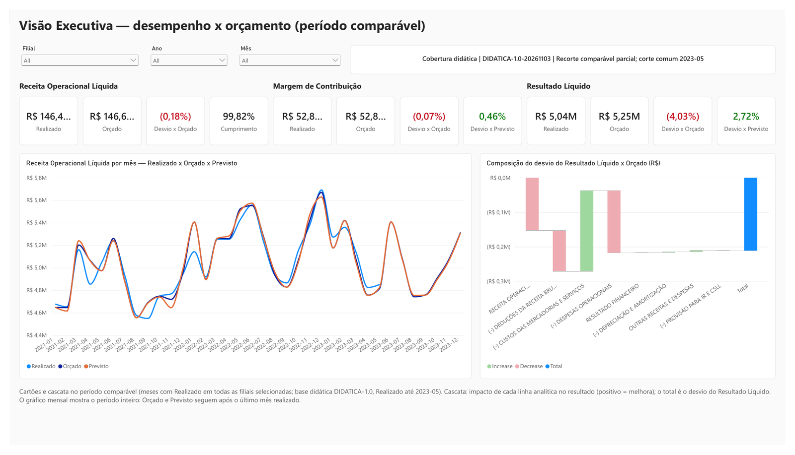
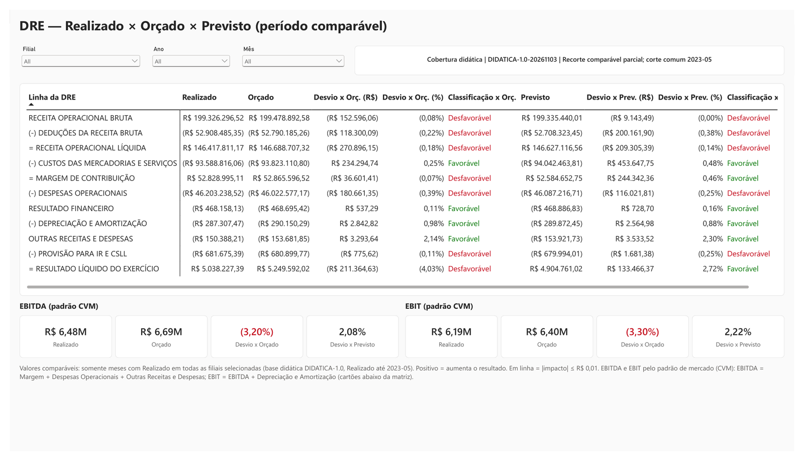
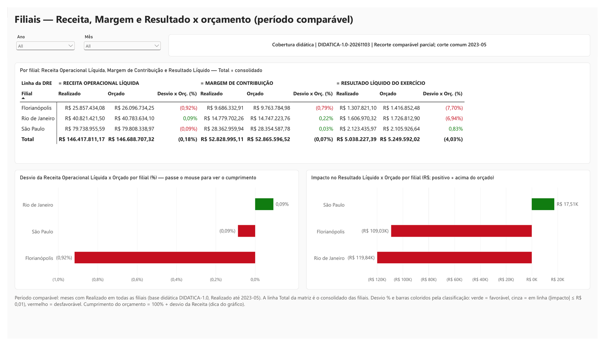
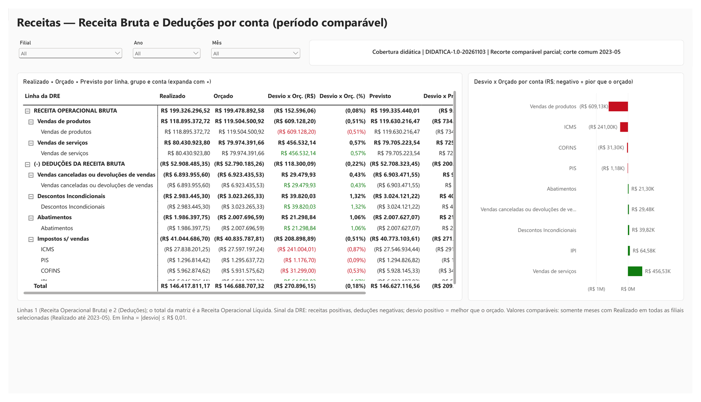
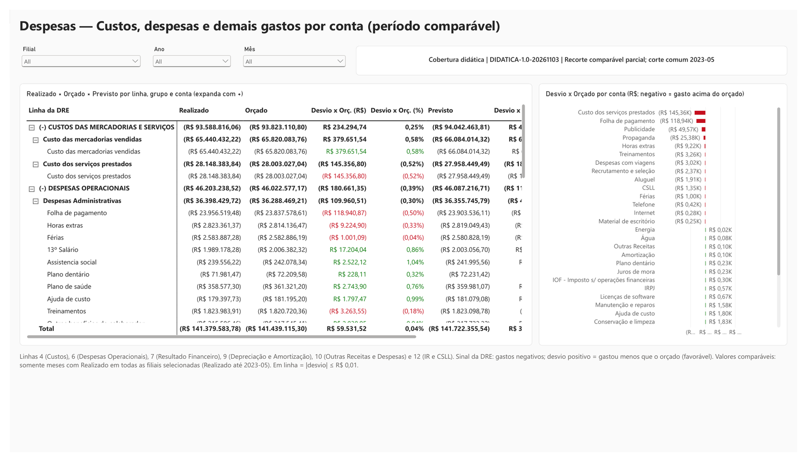

# DRE Moderno — Power BI + Databricks

Relatório de **Demonstração do Resultado do Exercício (DRE)** com Realizado, Orçado e Previsto para três filiais, construído em Power BI (formato PBIP/TMDL/PBIR) sobre uma camada *gold* no Databricks. Projeto de portfólio/estudo com base didática fictícia (`DIDATICA-1.0`).

## Destaques

- **Período comparável**: os desvios só usam meses em que todas as filiais selecionadas têm Realizado; filtros que pegam meses sem Realizado retornam vazio, e não um desvio falso.
- **Conciliação com a fonte**: cada lote de medidas foi conferido contra SQL independente no Databricks, com tolerância de R$ 0,01 e BLANK/NULL preservados (ver [docs/homologacao-fase5.md](docs/homologacao-fase5.md)).
- **Detalhamento por conta contábil**: linha da DRE → grupo → conta, com sinal contábil e mesma regra de período comparável.
- **Acessibilidade**: texto alternativo em todos os visuais, ordem de tabulação definida e segmentações sincronizadas entre páginas.

## Telas

| Executiva | DRE |
| --- | --- |
|  |  |
| **Filiais** | **Receitas** |
|  |  |
| **Despesas** | |
|  | |

## Páginas

| Página | Conteúdo |
| --- | --- |
| Executiva | Cartões de Receita Líquida, Margem de Contribuição e Resultado Líquido (Realizado, Orçado, desvios, cumprimento); Receita Líquida mensal; cascata do desvio do Resultado Líquido por linha |
| DRE | Matriz das linhas da DRE com Realizado, Orçado, Previsto, desvios em R$ e % e classificação colorida; cartões de EBITDA e EBIT |
| Filiais | Receita Líquida, Margem e Resultado por filial; desvio da Receita e impacto no Resultado por filial |
| Receitas | Receita Bruta e Deduções por grupo e conta; desvio por conta |
| Despesas | Custos, despesas operacionais, resultado financeiro, depreciação, outras e IR/CSLL por grupo e conta; desvio por conta |

## Arquitetura

```text
Databricks (workspace.gold)                Power BI (import)
  fato_lancamentos  ─┐                      dim_calendario (tabela de datas)
  fato_orcamento    ─┼─► vw_dre_comparativo ─► dim_filial
  fato_previsao     ─┘                      dim_conta (linha DRE, grupo, conta)
  dim_conta, dim_dre, dim_filial            _ConfigCobertura (meses com Realizado)
                                            _Medidas (87 medidas)
```

- Modelo estrela com relacionamentos de direção única; data automática desligada; medidas implícitas desestimuladas.
- `_ConfigCobertura` registra, por filial e cenário, os meses cobertos; é a base da regra de período comparável.

### Medidas (pasta `_Medidas`)

| Pasta | Conteúdo |
| --- | --- |
| DRE\Bases e linhas | Realizado, Orçado e Previsto por linha da DRE |
| DRE\Comparabilidade | Valores comparáveis, pares filial-mês e status do recorte |
| DRE\Desvios | Desvio Realizado x Orçado/Previsto em R$ e % |
| DRE\Desempenho | Impacto no resultado, classificação (Favorável / Em linha / Desfavorável) e cumprimento orçamentário |
| DRE\Formatação | Cores de classificação (ocultas, usadas em formatação condicional) |
| DRE\EBITDA e EBIT | EBITDA e EBIT (padrão CVM) com comparáveis, desvios e classificação |
| Contas | Mesmas métricas por conta contábil |

Convenções: receitas positivas e gastos negativos (sinal da DRE); desvio positivo = melhor que a referência; "Em linha" quando |desvio| ≤ R$ 0,01.

## Como abrir

1. Power BI Desktop recente, com suporte a projetos PBIP.
2. Abrir `DRE Moderno - Databricks2.pbip`.
3. Para atualizar dados: Página Inicial → Transformar dados → Editar parâmetros, preencher `DatabricksHost` (ex.: `seu-workspace.cloud.databricks.com`) e `DatabricksHttpPath` (caminho HTTP do SQL Warehouse), atualizar e autenticar com as suas credenciais (OAuth ou token pessoal). O repositório não contém credenciais.

## Estrutura

```text
DRE Moderno - Databricks2.pbip
DRE Moderno - Databricks2.SemanticModel/   modelo (TMDL)
DRE Moderno - Databricks2.Report/          relatório (PBIR)
docs/                                      planos, validações, evidências e homologação
PLANS.md                                   fases e status
AGENTS.md, CLAUDE.md                       regras de trabalho e segurança
```

## Validação

| Teste | Resultado |
| --- | --- |
| Indicadores base × SQL independente (filial × mês × 11 linhas × 3 cenários) | 9/9 conjuntos idênticos |
| Comparáveis, desvios, impacto, classificação e cumprimento × SQL (5 grupos × 7 recortes × 3 linhas) | 1.260/1.260 |
| Regressão das medidas da DRE após otimizações | 53.300/53.300 células |
| Medidas por conta × Databricks | 9/9 conjuntos (3.741 células por cenário) |
| EBITDA e EBIT × SQL (5 grupos × 7 recortes) | 665/665 |

Controles (Realizado consolidado, período inteiro): Receita Líquida R$ 146.417.811,17; Margem de Contribuição R$ 52.828.995,11; EBITDA R$ 6.475.368,38; EBIT R$ 6.188.060,91; Resultado Líquido R$ 5.038.227,39.

## Limitações

- Base didática fictícia: Realizado até 2023-05; Orçado e Previsto até 2023-12.
- Cultura do modelo en-US (formatos numéricos definidos nas medidas).
- EBITDA e EBIT não vêm calculados da fonte; são medidas DAX pelo padrão de mercado (CVM): EBITDA = Margem de Contribuição + Despesas Operacionais + Outras Receitas e Despesas; EBIT = EBITDA + Depreciação e Amortização.

## Licença

Código e documentação sob licença [MIT](LICENSE). Dados fictícios (base didática).
